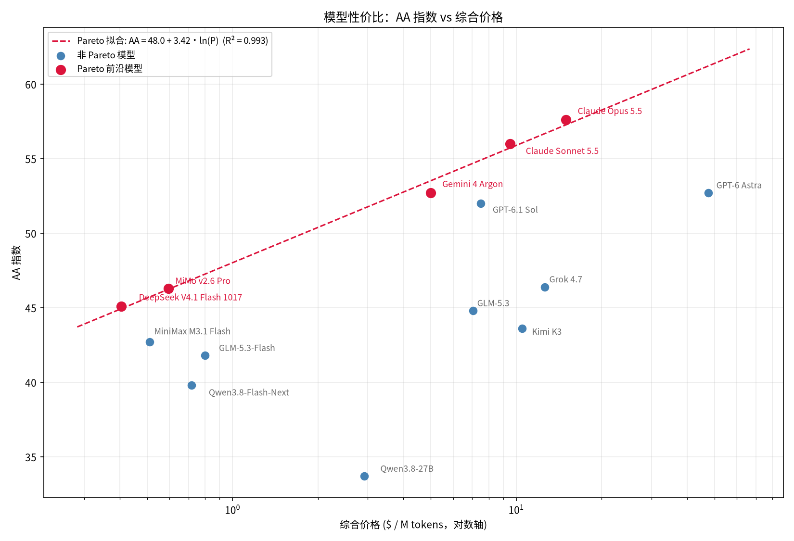

# 模型选择

数据收纳几类模型：

1. 闭源最强大模型。三个：Gemini 4 Carbon、Claude Opus 5.5和Claude Sonnet 5.5。其中 Carbon 尚未公开开放，先作为候选收录。
2. 开源最强大模型。两个：MiMo v2.6 Pro和Kimi K3.1 Pro。
3. 个人低成本独立部署。一个：Qwen3.8-27B。
4. 公司可离线部署。两个：GLM-5.3-Flash和Qwen3.8-Flash-Next。
5. 可执行任务廉价模型。两个：DeepSeek V4.1 Flash 1017和MiniMax M3.1 Flash。

其中：

- 个人低成本部署的线，划定在了32G统一内存上。Q4量化的话，参数量大约在40-50B以下。
- 公司离线部署的线，划定在了256G统一内存上。Q4量化的话，参数量大约在300-400B以下。同时，激活参数量最好在20B以下。
- 可执行任务廉价模型，划定在 API 综合价格低于 $1/百万 tokens、具备 agent 或工具执行能力、且未归入上述任何类别的模型。

# 固有参数

| 模型 | 发布时间 | 开放性 | 参数量 | 激活参数量 | 多模态 | 上下文 | 下载 |
|---|---:|---:|---:|---:|---:|---:|---|
| [GPT-6 Astra](https://developers.openai.com/api/docs/models/gpt-6-astra) | 2026-09-03 | 闭 | -- | -- | V | 1M | -- |
| [GPT-6.1 Sol](https://developers.openai.com/api/docs/models/gpt-6.1-sol) | 2026-09-29 | 闭 | -- | -- | V | 1.05M | -- |
| [Claude Opus 5.5](https://www.anthropic.com/claude-opus-5-5) | 2026-09-22 | 闭 | -- | -- | V | 1M | -- |
| [Claude Sonnet 5.5](https://www.anthropic.com/claude-sonnet-5-5) | 2026-09-28 | 闭 | -- | -- | V | 1M | -- |
| [Gemini 4 Carbon](https://blog.google/innovation-and-ai/models-and-research/gemini-models/introducing-gemini-4-carbon/) | 2026-10-28 | 闭 | -- | -- | V/A | 1M | -- |
| [Gemini 4 Argon](https://blog.google/intl/zh-tw/products/explore-get-answers/gemini-4-argon/) | 2026-09-30 | 闭 | -- | -- | V/A | 1M | -- |
| [Grok 4.7](https://x.ai/news/grok-4-7) | 2026-09-21 | 闭 | -- | -- | V | 500k | -- |
| [Kimi K3.1 Pro](https://www.kimi.ai/blog/kimi-k3-1-pro) | 2026-10-24 | 开 | 2.8T | 104B | V | 1M | 尚未释出，11 月 4 日前发布权重 |
| [MiMo v2.6 Pro](https://mimo.mi.com/docs/zh-CN/news/latest/v2-6) | 2026-09-21 | 开 | 1.02T | 42B | V/A | 1M | [权重](https://huggingface.co/XiaomiMiMo/MiMo-V2.6-Pro-RL) |
| [GLM-5.3](https://z.ai/blog/glm-5.3) | 2026-08-14 | 开 | 744B | 40B | -- | 1M | [权重](https://huggingface.co/zai-org/GLM-5.3) · [GGUF](https://huggingface.co/unsloth/GLM-5.3-GGUF) |
| [GLM-5.3-Flash](https://z.ai/blog/glm-5.3-flash) | 2026-08-26 | 开 | 320B | 18B | V | 1M | [权重](https://huggingface.co/zai-org/GLM-5.3-Flash) · [GGUF](https://huggingface.co/unsloth/GLM-5.3-Flash-GGUF) |
| [DeepSeek V4.1 Flash 1017](https://huggingface.co/deepseek-ai/DeepSeek-V4.1-Flash-1017) | 2026-10-17 | 开 | 552B/763B | 8B/16B | V | 1M | [权重](https://huggingface.co/deepseek-ai/DeepSeek-V4.1-Flash-1017) · [GGUF](https://huggingface.co/unsloth/DeepSeek-V4.1-Flash-1017-GGUF) |
| [MiniMax M3.1 Flash](https://www.minimax.io/blog/minimax-m31f) | 2026-10-19 | 开 | 未知 | 未知 | V | 1M | 尚未释出 |
| [Qwen3.8-Flash-Next](https://qwen.ai/blog?id=qwen3.8-flash-next) | 2026-08-26 | 开 | 180B | 6B | V | 262k | [权重](https://huggingface.co/Qwen/Qwen3.8-Flash-Next) · [GGUF](https://huggingface.co/unsloth/Qwen3.8-Flash-Next-GGUF) |
| [Qwen3.8-27B](https://qwen.ai/blog?id=qwen3.8) | 2026-08-14 | 开 | 27B | 27B | V | 262k | [权重](https://huggingface.co/Qwen/Qwen3.8-27B) · [GGUF](https://huggingface.co/unsloth/Qwen3.8-27B-GGUF) |

- 多模态列仅记录非文本输入：`V` 表示视觉（图像或视频），`A` 表示音频，`--` 表示仅支持文本输入。
- Gemini 4 Carbon 截至 2026-10-29 仅向部分可信网络防御伙伴逐步开放，尚未公开提供 API；1M 上下文和多模态输入规格采用 [AA 模型页](https://artificialanalysis.ai/models/gemini-4-carbon)。Argon 的 2026-09-30 为首次宣布日期，公开 API 于 2026-10-13 上线。
- 我们目前无法百分百确认 Qwen3.8-Flash 的底层就是 Qwen3.8-Flash-Next，但是目前有很强证据证明二者是一回事。因此表格内采用 Qwen3.8-Flash-Next 的名字和固有参数、Qwen3.8-Flash 的价格，以及 Qwen3.8-Flash-Next 的 Benchmark 分数，并将其列为开源模型。
- DeepSeek V4.1 Flash 1017 的 552B 为 backbone 参数量，激活参数为 prefill 8B / decode 16B（因果编码器-解码器架构）；另含 196B Engram 条件记忆与视觉编码器，权重合计 763B。
- MiniMax M3.1 Flash 按官方后续开放权重的计划标为“开”；截至 2026-10-20，权重尚未释出，总参数量和激活参数量均未获官方确认。

# API 价格

| 模型 | 输入价格 | 输出价格 | 缓存读取 | 缓存写入 | 综合价格 |
|---|---:|---:|---:|---:|---:|
| GPT-6 Astra | \$10 | \$50 | \$1 | \$12.5 | \$47.5 |
| GPT-6.1 Sol | \$2 | \$10 | \$0.1 | \$2.5 | \$7.5 |
| Claude Opus 5.5 | \$4 | \$20 | \$0.2 | \$5 | \$15 |
| Claude Sonnet 5.5 | \$2 | \$10 | \$0.2 | \$2.5 | \$9.5 |
| Gemini 4 Carbon | \$4 | \$20 | \$0.2 | -- | \$10 |
| Gemini 4 Argon | \$4 | \$20 | \$0.2 | -- | \$10 |
| Grok 4.7 | \$2 | \$6 | \$0.5 | -- | \$12.6 |
| Kimi K3.1 Pro | \$2 | \$10 | \$0.2 | \$2 | \$9 |
| MiMo v2.6 Pro | \$0.435 | \$0.87 | \$0.0036 | -- | \$0.594 |
| GLM-5.3 | \$1.4 | \$4.4 | \$0.26 | -- | \$7.04 |
| GLM-5.3-Flash | \$0.15 | \$0.5 | \$0.03 | -- | \$0.8 |
| DeepSeek V4.1 Flash 1017 | \$0.30 / \$0.15 | \$1.20 / \$0.60 | \$0.006 / \$0.003 | -- | \$0.405 |
| MiniMax M3.1 Flash | \$0.15 | \$0.60 | \$0.015 | -- | \$0.51 |
| Qwen3.8-Flash-Next | \$0.15 | \$0.47 | \$0.016 | \$0.2 | \$0.717 |
| Qwen3.8-27B | \$0.425 | \$2.55 | \$0.085 | \$0.53125 | \$2.91125 |

- 不参考套餐/批量折扣/限时优惠价格，表中采用官方原价。
- 综合价格按“0.1 × 输出价格 + 输入价格 + 20 × 缓存读取价格 + 缓存写入价格”计算。未提供缓存写入价格的 `--` 在本项计算中按 0 计。它表示实际载荷每处理 1M 输入 tokens 对应的真实成本：与这 1M 输入对应的输出、缓存读取和缓存写入量，分别按实际比例乘以各自单价后，与输入成本相加。
- 有峰谷价格的，综合价格按峰谷价的平均数计算。
- Gemini 4 Carbon 和 Argon 均按标准原价记录。Argon 优惠截至 2026-11-30，Carbon 优惠结束日期尚未公布。
- Grok 4.7 的 prompt ≥200K 长文档位（输入/输出/缓存读取翻倍）与 2 倍价格的 fast 变体均未计入，综合价格按 <200K 标准档计算。

# 指标选择

指标选择的要求是有公信力（不好刷题），有区分度（没有饱和），数据齐全（模型都有）。Scicode 与其他评测中个别缺失的成绩标记为 `--`。下面是几个参考指标。

- **[SciCode](https://artificialanalysis.ai/evaluations/scicode)**：用多个科学领域的高难编程问题衡量代码生成和算法实现能力；AA 当前对该数据集标记为 Under review，成绩应谨慎使用。
- **[Terminal-Bench 4.0](https://artificialanalysis.ai/evaluations/terminalbench-4-0)**：用 66 项更难的真实终端任务衡量 agent 的命令执行、环境操作、错误恢复和长流程完成能力，调整了计算资源和时间限制，并改进指令、运行环境与验证器。
- **[AutomationBench](https://artificialanalysis.ai/evaluations/automationbench-aa)**：用 657 个模拟 SaaS 工作流衡量 agent 的跨应用工具调用、业务规则执行、状态修改和安全约束遵守能力；当前表采用 AA 的 AutomationBench-AA 分数。
- **[HLE](https://artificialanalysis.ai/evaluations/humanitys-last-exam)**：用专家审核的跨学科前沿问题衡量知识与高难推理的综合能力；原始题集有 2500 题，AA 本列实际采用 2158 道纯文本题、无工具评测，不与 1000 题的 HLE-Diamond 混用。
- **[CritPt](https://artificialanalysis.ai/evaluations/critpt)**：用物理学研究者设计的 70 道未公开前沿问题衡量研究级科学推理能力，采用数值数组、符号表达式和 Python 函数等抗猜测答案格式；保留原版，不与带代码执行工具的 CritPt v2 混用。
- **[AA 指数](https://artificialanalysis.ai/articles/artificial-analysis-intelligence-index-v5)**：采用 2026-10-27 发布的 v5.0，以九项独立评测生成综合分，作为快速比较模型整体水平的摘要而不是新的独立能力维度。v5 移除了 SciCode，HLE 和 CritPt 分别升级为 HLE-Diamond 和 CritPt v2 hard subset；本表仍独立保留旧版基础指标，因此 AA 指数不是这五列的平均值，亦不能与旧表 v4.3.2 分数直接比较。
- 五个基础指标按能力分组为：SciCode、Terminal-Bench 4.0（代码）；AutomationBench（Agent 执行）；HLE、CritPt（推理）。AA 指数单独作为综合指标保留。

# Benchmark 数据

| 模型 | SciCode | Terminal-Bench 4.0 | AutomationBench | HLE | CritPt | AA指数 v5.0 | 性价比 |
|---|---:|---:|---:|---:|---:|---:|---:|
| [GPT-6 Astra](https://artificialanalysis.ai/models/gpt-6-astra) | 56.5% | 59.1% | 68.5% | 54.7% | 31.7% | 56.9 | 78.8% |
| [GPT-6.1 Sol](https://artificialanalysis.ai/models/gpt-6-1-sol) | 54.2% | 56.1% | 64.9% | 52.9% | 31.7% | 54.5 | **95.6%** |
| [Claude Opus 5.5 (with fallback)](https://artificialanalysis.ai/models/claude-opus-5-5) | 66.9% | 59.6% | 69.5% | 61.4% | 31.7% | 58.4 | 93.1% |
| [Claude Sonnet 5.5 (with fallback)](https://artificialanalysis.ai/models/claude-sonnet-5-5) | 61.0% | 63.6% | 71.8% | 55.0% | 31.4% | 54.2 | 91.9% |
| [Gemini 4 Carbon](https://artificialanalysis.ai/models/gemini-4-carbon) | 64.2% | 65.2% | 77.8% | 60.4% | 36.0% | 59.4 | **100.0%** |
| [Gemini 4 Argon](https://artificialanalysis.ai/models/gemini-4-argon) | 61.8% | 57.1% | 77.5% | 57.1% | 27.1% | 50.4 | 84.8% |
| [Grok 4.7](https://artificialanalysis.ai/models/grok-4-7-high) | 57.8% | 24.7% | 63.5% | 42.3% | 18.0% | 35.0 | 57.1% |
| [Kimi K3.1 Pro](https://artificialanalysis.ai/models/kimi-k3-1-pro) | 60.8% | 67.2% | 73.3% | 52.5% | 24.6% | 46.0 | 78.6% |
| [MiMo v2.6 Pro](https://artificialanalysis.ai/models/mimo-v2-6-pro) | 60.9% | 34.8% | 58.6% | 49.4% | 26.6% | 29.9 | 82.6% |
| [GLM-5.3](https://artificialanalysis.ai/models/glm-5-3) | 59.0% | 41.9% | 62.2% | 42.3% | 19.1% | 31.7 | 56.1% |
| [GLM-5.3-Flash](https://artificialanalysis.ai/models/glm-5-3-flash) | 51.6% | 32.8% | 60.4% | 39.9% | 15.4% | -- | -- |
| [DeepSeek V4.1 Flash 1017](https://artificialanalysis.ai/models/deepseek-v4-1-flash-1017) | 55.9% | 33.8% | 66.6% | 43.3% | 24.0% | 32.5 | **98.3%** |
| [MiniMax M3.1 Flash](https://artificialanalysis.ai/models/minimax-m3-1-flash) | 53.4% | 25.8% | 72.5% | 48.0% | 22.3% | 28.9 | 82.7% |
| [Qwen3.8-Flash-Next](https://artificialanalysis.ai/models/qwen3-8-flash-next) | 50.6% | 25.3% | 55.9% | 38.0% | 11.1% | -- | -- |
| [Qwen3.8-27B](https://artificialanalysis.ai/models/qwen3-8-27b) | 46.6% | 5.6% | 48.2% | 33.9% | 5.4% | 20.1 | 40.8% |

- 数据核查日期：2026-10-29；AA 指数版本：v5.0。表中 AA 指数保留一位小数。
- SciCode 整项评测当前为 Under review，保留 AA 已发布成绩并提示审查状态；不再沿用仅 MiniMax 的 SciCode/CritPt 处于审查中的旧注释。
- 数据优先采用AA独立评测，其次采用官方模型卡/报告。两者均不存在时，参考采信第三方评价或官方估计值。
- 闭源推理模型使用表中成绩对应的高推理档位；Claude Opus/Sonnet 5.5 的 AA 评测启用了默认 fallback，因此单独标注。
- GPT-6 Astra、GPT-6.1 Sol、Claude Opus/Sonnet 5.5、GLM-5.3 和 DeepSeek V4.1 Flash 1017 使用 Max 档；Gemini 4 Carbon、Argon 和 Grok 4.7 使用 High 档；Qwen3.8-27B 使用 Xhigh 档，其余使用各自默认推理档位。

## 性价比

- 性价比使用上文 API 价格区块的综合价格与本区块的 AA 指数计算。
- 性价比从当前表中选出“相同或更低综合价格下不存在更高 AA 指数模型”的全部 Pareto 前沿模型，拟合得到性价比预测线。然后计算每个模型的 AA 指数相对预测指数的百分比，再对总体归一化。归一化采用所有模型性价比乘以当前模型集合中最高原始性价比的倒数，使最高分恰为 100%，其余分数均落在 0–100% 区间。性价比是当前模型集合内的相对比较，模型或价格变化后需要重新筛选 Pareto 前沿并整体重算。
- 当前拟合得到的性价比预测线为 `预期 AA 指数 = 39.6482 + 8.0429 × ln(综合价格)`（R² = 0.992）。归一化为 `实际 AA 指数 / 预期 AA 指数 × 97.9253%`。
- GLM-5.3-Flash 和 Qwen3.8-Flash-Next 暂无 AA v5.0 指数，性价比记为 `--`，不参与拟合与绘图。图中包含尚未公开开放的 Carbon，因此 Pareto 前沿不等同于当前可用 API 的采购建议。
- Pareto模型的性价比已经被加粗。
- 价格-AA 关系图（横轴为对数综合价格，纵轴为 AA 指数，红点为 Pareto 前沿模型，红色虚线为 Pareto 拟合线）：

  

# 用户反馈收集

- 闭源里面，Opus 5.5是偏好评的。
- Opus 5.5反馈逆天，号称“全球最好用模型”，“老实干活儿的老二回来了，还当了老大”。
- Astra的评价极度两极分化。
- Grok被吐槽“只有NSFW是刚需”。而且这批人还在流向Qwen3.8-27B。
- 开源里面，MiMo v2.6 Pro中评偏差。评价是“性价比高跑分漂亮，然而不能干活儿”。
- GLM-5.3/GLM-5.3-Flash好评。前者便宜，后者可本地部署。缺点是不知为何，坚信自己是claude。
- K3 评价两极分化，主要优点是细节封神，主要缺点是贵且慢；Kimi K3.1 Pro 的用户反馈待收集。
- DeepSeek V4.1 Flash也是两极分化。速度封神，编码拉胯。而且啰里八嗦的。
- Qwen3.8-Flash-Next意外的强。但只有一个供应商。
- Qwen3.8-27B，低成本本地执行的唯一选择，也无需在意评价了。

# 点评

- 评测升级到5之后，很多模型评分就大幅降低了。
- 最强阵营里，Opus 5.5的领先位置被大幅降低，又恢复了御三家混战的格局。
- Kimi K3.1 Pro从第四到了第九，变成第一阵营吊车尾。
- 第二集群里，GLM-5.3 的 AA 指数被 DeepSeek V4.1 Flash 1017 反超。这个集群实际上已经没什么价值了。
- 高性价比部分。MiMo v2.6 Pro 的评分被大幅下调，反而落后于 DeepSeek V4.1 Flash 1017 了。DeepSeek V4.1 Flash 1017 直接封神。
- Qwen3.8-27B自己一桌吃饭，地位始终无人挑战。
